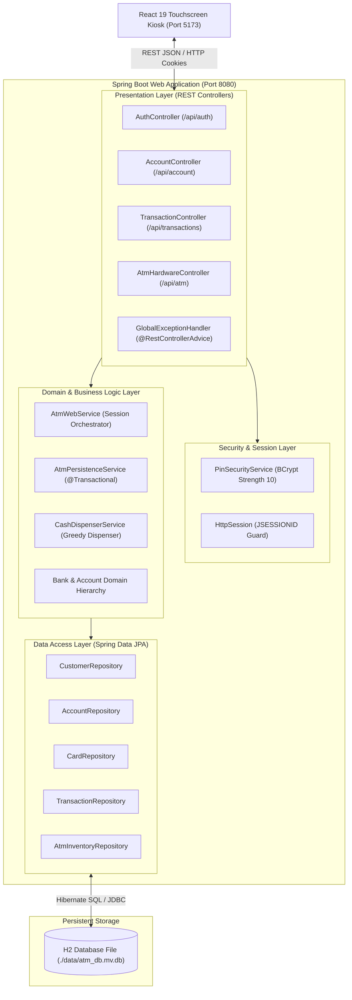
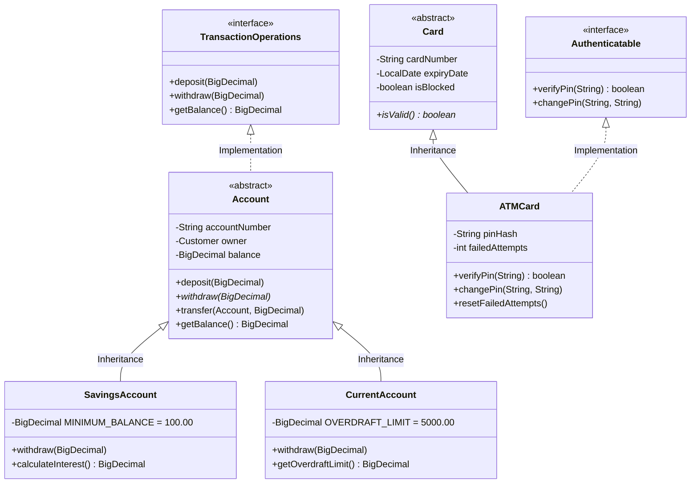
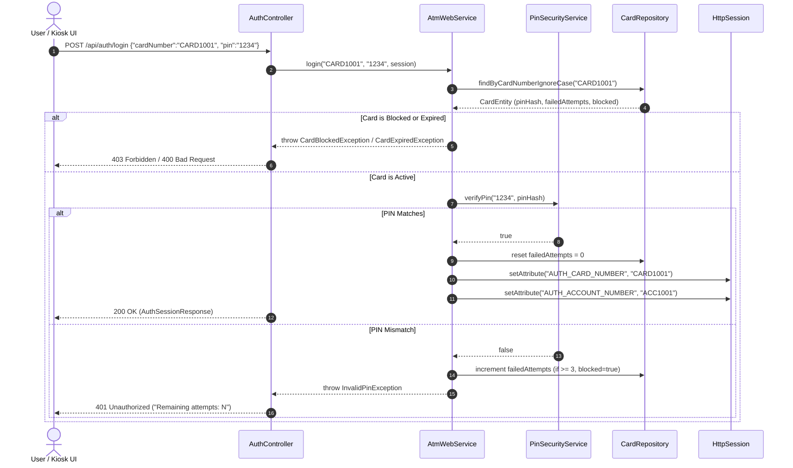
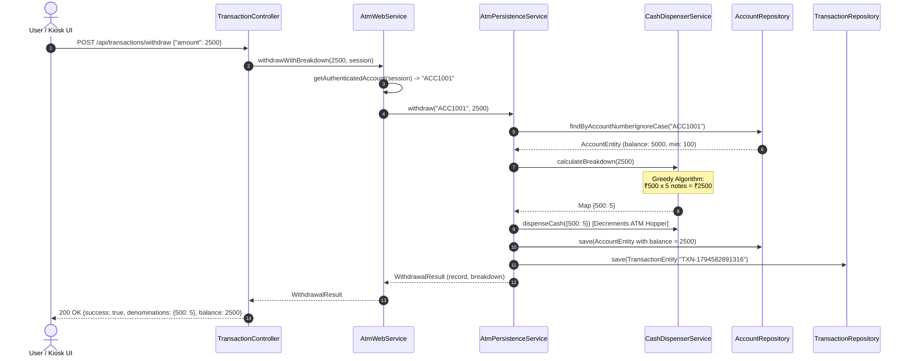

# APEX ATM Banking System — Backend Architecture & Engineering Guide

---

## 1. Executive Technical Overview

The **APEX ATM System** backend is an enterprise-grade, object-oriented financial simulation engine engineered with **Java 17 LTS** and **Spring Boot 3.3.4**. It powers the physical kiosk hardware simulation, authenticates EMV card sessions, executes ACID-compliant banking transactions, computes greedy currency denomination breakdowns, and enforces zero-trust security standards.

### Technology Stack
- **Language**: Java 17 LTS (Microsoft OpenJDK 17.0.20)
- **Framework**: Spring Boot 3.3.4 (Spring Web MVC, Spring Data JPA, Spring Validation)
- **Security & Cryptography**: Spring Security Crypto (`BCryptPasswordEncoder`, strength = 10)
- **Persistence & ORM**: Hibernate 6.5.3.Final / Jakarta Persistence API (JPA)
- **Database Engine**: H2 Relational Database Engine 2.3.232 (embedded file-backed persistent store `./data/atm_db`)
- **Web Container**: Apache Tomcat 10.1 (embedded)
- **Testing**: JUnit Jupiter 5.10.3, AssertJ, Spring Test (`@SpringBootTest`, `MockMvc`)
- **Build System**: Apache Maven 3.9.9 via Maven Wrapper (`mvnw.cmd`)

---

## 2. High-Level System Architecture

The backend follows a strictly decoupled, **Layered Architecture (N-Tier)** enforcing Single Responsibility and Separation of Concerns:



---

## 3. Layer-by-Layer Architectural Breakdown

### 3.1 Presentation Layer (`com.bank.atm.controller`)
Exposes RESTful JSON endpoints following REST semantics (`GET` for idempotent queries, `POST` for state mutations):

| Controller | Base Path | Key Responsibilities |
| :--- | :--- | :--- |
| `AuthController` | `/api/auth` | Validates card status, verifies BCrypt PIN, binds `AUTH_CARD_NUMBER` and `AUTH_ACCOUNT_NUMBER` to HTTP Session, invalidates sessions upon logout. |
| `AccountController` | `/api/account` | Retrieves authenticated user profile, ledger balance, available balance, and masked account identifiers. |
| `TransactionController` | `/api/transactions` | Handles cash deposits, cash withdrawals with note breakdown, account-to-account fund transfers, and ledger query filtering. |
| `AtmHardwareController` | `/api/atm` | Exposes terminal hardware health, cash inventory reserves, supported denominations, and demo card unblocking. |

#### Input Validation:
All DTOs (`LoginRequest`, `DepositRequest`, `WithdrawRequest`, `TransferRequest`, `ChangePinRequest`) use Jakarta Bean Validation annotations:
- `@NotBlank(message = "...")`: Prevents null or whitespace payloads.
- `@Pattern(regexp = "^\\d{4}$")`: Strictly restricts PIN inputs to 4 decimal digits.
- `@Positive(message = "...")`: Ensures financial transaction amounts are strictly greater than zero.

---

### 3.2 Global Exception Handling (`com.bank.atm.exception`)
Centralized in `GlobalExceptionHandler` via `@RestControllerAdvice`:
- Maps custom domain exceptions to standard HTTP status codes:
  - `AccountNotFoundException` &rarr; `404 NOT FOUND`
  - `CardBlockedException` &rarr; `403 FORBIDDEN`
  - `CardExpiredException`, `InvalidAmountException` &rarr; `400 BAD REQUEST`
  - `InvalidPinException` &rarr; `401 UNAUTHORIZED`
  - `InsufficientFundsException` &rarr; `400 BAD REQUEST`
  - `DataIntegrityViolationException` &rarr; `409 CONFLICT`
  - `MethodArgumentNotValidException` &rarr; `400 BAD REQUEST` with consolidated field-level error messages.
- **Security Sanitization**: Any unexpected generic exception (`Exception.class`) is logged server-side with its stack trace via SLF4J, while returning a safe, sanitized error message to the client, preventing internal SQL or server internals leakage.

---

### 3.3 Security & Session Management (`com.bank.atm.security`)
1. **BCrypt PIN Hashing**:
   - ATMs never store plaintext PINs. `PinSecurityService` uses `BCryptPasswordEncoder(10)` with auto-generated salts.
   - Constant-time verification prevents side-channel timing attacks.
2. **Three-Strike Lockout Policy**:
   - `CardEntity.failedAttempts` tracks bad attempts.
   - After 3 consecutive incorrect PIN entries, `CardEntity.blocked` is set to `true`, and all subsequent attempts throw `CardBlockedException`.
   - On a successful login, `failedAttempts` is immediately reset to 0.
3. **Session Authentication Guard**:
   - `AtmWebService.getAuthenticatedAccount(session)` inspects the secure servlet session (`JSESSIONID`).
   - If an unauthenticated request attempts to deposit, withdraw, transfer, or check balance, an `IllegalStateException` is thrown and mapped to `401 Unauthorized`.

---

### 3.4 Transaction Management & ACID Guarantees (`com.bank.atm.service`)
All state-modifying operations in `AtmPersistenceService` are annotated with Spring's `@Transactional`:

```java
@Transactional
public TransactionRecord transfer(String senderAccountNumber, String recipientAccountNumber, BigDecimal amount)
        throws AccountNotFoundException, InvalidAmountException, InsufficientFundsException {
    // 1. Fetch both accounts
    AccountEntity sender = accountRepository.findByAccountNumberIgnoreCase(senderAccountNumber)...
    AccountEntity receiver = accountRepository.findByAccountNumberIgnoreCase(recipientAccountNumber)...
    
    // 2. Validate minimum balance constraint
    BigDecimal senderNewBalance = sender.getBalance().subtract(amount);
    if (senderNewBalance.compareTo(sender.getMinimumBalance()) < 0) {
        throw new InsufficientFundsException("Transfer would violate minimum balance.");
    }
    
    // 3. Mutate balances
    sender.setBalance(senderNewBalance);
    receiver.setBalance(receiver.getBalance().add(amount));
    
    // 4. Persist updated accounts
    accountRepository.save(sender);
    accountRepository.save(receiver);
    
    // 5. Generate monotonic transaction IDs & record dual ledger entries
    TransactionEntity senderTxn = new TransactionEntity(...);
    TransactionEntity receiverTxn = new TransactionEntity(...);
    transactionRepository.save(senderTxn);
    transactionRepository.save(receiverTxn);
    
    return new TransactionRecord(...);
}
```

#### ACID Compliance:
- **Atomicity**: If debiting sender succeeds but saving receiver transaction fails, the entire transaction is rolled back. No money is ever lost or created.
- **Consistency**: Minimum balance invariants (₹100 for Savings, ₹0 for Current) are strictly checked prior to mutation.
- **Isolation**: Read Committed / Serializable isolation guarantees accurate balances.
- **Durability**: Changes are committed to H2 database files on disk (`./data/atm_db.mv.db`).

---

### 3.5 Currency Dispensing Algorithm (`CashDispenserService`)
Cash dispensing uses a **Greedy Coin-Change Algorithm with Finite Inventory Constraints**:

1. Target amount must be positive, a multiple of ₹100, and &le; ₹20,000 (single transaction limit).
2. The ATM maintains physical banknote counts for denominations: `[500, 200, 100]`.
3. Iterating in descending denomination order:
   $$\text{notesToDispense} = \min\left(\left\lfloor \frac{\text{remaining}}{\text{denom}} \right\rfloor, \text{inventoryCount}\right)$$
4. The remaining balance is decremented:
   $$\text{remaining} \leftarrow \text{remaining} - (\text{notesToDispense} \times \text{denom})$$
5. If $\text{remaining} > 0$ after checking all supported denominations, an `InvalidAmountException` is raised ("ATM cash inventory cannot dispense this exact amount").
6. If successful, the ATM hardware inventory is atomically updated in the database.

---

### 3.6 Deadlock Prevention in Concurrent Transfers
In multi-threaded banking environments, two accounts transferring to each other simultaneously can trigger a circular wait deadlock (Coffman Condition):
- Thread 1: Locks Account A, waits for Account B.
- Thread 2: Locks Account B, waits for Account A.

`AtmWebService` eliminates this via **Strict Lexicographical Resource Ordering**:
```java
Account firstLock = memSender.getAccountNumber().compareTo(memReceiver.getAccountNumber()) < 0 ? memSender : memReceiver;
Account secondLock = firstLock == memSender ? memReceiver : memSender;

synchronized (firstLock) {
    synchronized (secondLock) {
        memSender.transfer(memReceiver, amount);
    }
}
```
Because locks are always acquired in deterministic alphabetical order (`ACC1001` before `ACC1002`), circular wait is mathematically impossible.

---

### 3.7 Globally Unique Monotonic Transaction IDs
To prevent primary key collisions in the `transactions` table across application restarts, `AtmPersistenceService` uses:
```java
private static final AtomicLong TXN_COUNTER = new AtomicLong(System.currentTimeMillis());

private String generateTxnId() {
    return "TXN-" + TXN_COUNTER.incrementAndGet();
}
```
This guarantees thread-safe, non-colliding, chronological transaction IDs (e.g., `TXN-1794582891312`).

---

## 4. Object-Oriented Design (OOP) Principles Applied



1. **Inheritance**:
   - `SavingsAccount` and `CurrentAccount` inherit from abstract `Account`, reusing account number, owner, and deposit logic while overriding `withdraw()` with specific account-type rules.
   - `ATMCard` inherits common card properties from abstract `Card`.
2. **Polymorphism**:
   - `Account.withdraw()` behaves polymorphically: `SavingsAccount` prevents withdrawals breaching the ₹100 minimum balance, while `CurrentAccount` allows overdraft up to ₹5,000.
3. **Abstraction**:
   - Interfaces (`Authenticatable`, `Printable`, `TransactionOperations`) decouple service callers from concrete implementations.
4. **Encapsulation**:
   - All state fields (`balance`, `pinHash`, `failedAttempts`) are `private`. Mutations only occur through validated domain methods enforcing invariants.

---

## 5. End-to-End Request Lifecycles

### Flow A: Card Insertion & PIN Authentication


---

### Flow B: Cash Withdrawal & Dispensing


---

## 6. Examiner / Technical Viva Questions & Answers

### Q1: Why use Spring Boot instead of plain Java Servlets or a console application?
> **Answer**: Spring Boot provides production-grade infrastructure:
> 1. **Inversion of Control (IoC) & Dependency Injection (DI)** decouples controllers from services and repositories, making components unit-testable with Mockito.
> 2. **Declarative Transaction Management (`@Transactional`)** ensures enterprise ACID guarantees without manual JDBC `commit()` and `rollback()` handling.
> 3. **Spring Data JPA** eliminates boilerplate SQL queries through declarative repository interfaces.
> 4. **Embedded Tomcat** enables self-contained deployment (`java -jar`) without requiring an external application server.

---

### Q2: How does the backend prevent race conditions and double-spending?
> **Answer**: Two distinct layers of concurrency defense are employed:
> 1. **Database-level Transactions**: `@Transactional` isolates updates so concurrent requests do not read uncommitted dirty reads.
> 2. **Dual-Lock Resource Ordering**: In inter-account transfers, locks on domain accounts are acquired strictly in alphabetical order by account number (`compareTo`), preventing Coffman circular-wait deadlocks between concurrent transfers.

---

### Q3: How is customer security protected?
> **Answer**:
> 1. **Salted Hashing**: PINs are never stored in plaintext or reversible encryption; they are hashed with **BCrypt (cost factor 10)**.
> 2. **Brute-Force Lockout**: 3 failed PIN attempts permanently block the card until an administrator or branch unblocks it.
> 3. **Identifier Masking**: Account numbers (`ACC••••1001`) and card numbers (`•••• •••• •••• 1001`) are masked before transmission across public APIs.
> 4. **Session Guard**: All financial endpoints require an active, validated HTTP session cookie tied to an authenticated card.

---

### Q4: How does the Cash Dispenser handle low cash inventory?
> **Answer**: The `CashDispenserService` checks the real-time banknote counts stored in `AtmInventoryEntity`. If the ATM lacks sufficient notes to fulfill an exact combination (e.g. user requests ₹300, but only ₹500 notes remain), the greedy calculation detects a non-zero remainder and throws an `InvalidAmountException`, cleanly aborting the transaction before any user balance is deducted.

---

### Q5: What database is used and how does persistence survive app restarts?
> **Answer**: The application uses an **H2 Embedded Relational Database** running in **file-backed mode** (`jdbc:h2:file:./data/atm_db`). Unlike in-memory H2 databases (`jdbc:h2:mem:...`) that wipe data upon JVM termination, file-backed mode writes all customer profiles, account balances, card credentials, and historical transaction logs to persistent disk files in `./data/atm_db.mv.db`.

---

## 7. Database Entity Schema Reference

| Table | Entity Class | Primary Key | Key Columns |
| :--- | :--- | :--- | :--- |
| `customers` | `CustomerEntity` | `customer_id` (VARCHAR) | `full_name`, `phone_number`, `email` |
| `accounts` | `AccountEntity` | `account_number` (VARCHAR) | `account_type`, `balance`, `minimum_balance`, `customer_id` (FK) |
| `cards` | `CardEntity` | `card_number` (VARCHAR) | `pin_hash`, `expiry_date`, `failed_attempts`, `is_blocked`, `account_number` |
| `transactions` | `TransactionEntity` | `transaction_id` (VARCHAR) | `account_number`, `timestamp`, `type`, `debit_credit`, `amount`, `balance_after`, `remarks`, `note_breakdown` |
| `atm_inventory` | `AtmInventoryEntity` | `denomination` (INT) | `note_count` (INT) |

---

## 8. Summary of Preloaded Demo Data

| Card Number | Account Number | PIN | Customer Name | Account Type | Initial Balance | Special State |
| :--- | :--- | :--- | :--- | :--- | :--- | :--- |
| `CARD1001` | `ACC1001` | `1234` | Aarav Sharma | Savings Account | ₹5,000.00 | Normal / Demo |
| `CARD1002` | `ACC1002` | `5678` | Priya Patel | Current Account | ₹12,000.00 | Transfer Target |
| `CARD1003` | `ACC1003` | `4321` | Rahul Verma | Savings Account | ₹800.00 | **Expired Card** |
| `CARD1004` | `ACC1004` | `9999` | Neha Iyer | Savings Account | ₹1,500.00 | **Blocked Card** |
| `CARD1005` | `ACC1005` | `2468` | Vikram Malhotra | Savings Account | ₹150.00 | Low Balance |

