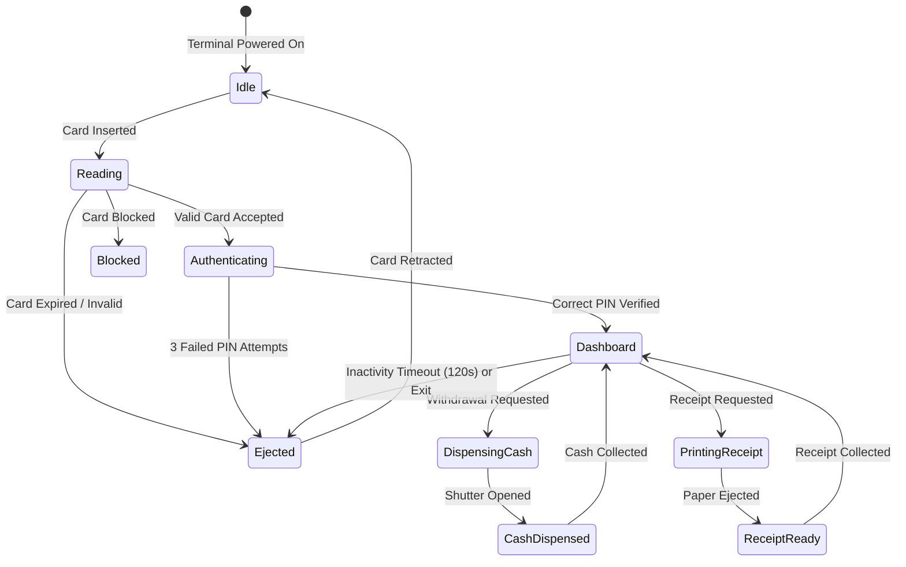

# APEX Touch Banking — Frontend Architecture & Technical Specification

> **Physical ATM Kiosk Simulation & Touchscreen Interface**  
> **Tech Stack**: React 19, TypeScript, Vite 6, Tailwind CSS, Motion for React, Web Audio API, Vitest  
> **Live Production URL**: [https://atmsystem-frontend.vercel.app/](https://atmsystem-frontend.vercel.app/)

---

## 1. System Overview

The frontend is a high-fidelity, production-grade Single Page Application (SPA) designed to simulate the physical user experience of a next-generation banking terminal (**Apex Prime X-9000**). 

Unlike typical web banking portals, this interface models physical automated teller hardware:
- **Card Reader**: Beveled intake slot with multi-state LED status indicators and accessible card flip preview.
- **PIN Pad**: Tactile 3D numeric keypad with real-time audio synthesis and hardware key synchronization.
- **Cash Dispenser**: Mechanical shutter door that illuminates and presents authentic Indian Rupee banknotes with interactive "Take Cash" collection.
- **Thermal Receipt Printer**: Protruding thermal receipt slot with serrated tear lines, monospaced banking slips, and native browser printing.
- **Physical Side Function Keys**: Side bezel buttons (`L1–L4`, `R1–R4`) that provide tactile shortcuts matching the on-screen action rows.

---

## 2. Directory Structure

```
frontend/
├── public/
│   ├── brand/app-icon/          # PWA, favicon, and Open Graph vector assets
│   ├── favicon.svg              # Browser tab icon
│   └── robots.txt               # Search engine directives
├── src/
│   ├── assets/
│   │   └── brand/               # Official vector lockups, monograms, and network logos
│   │       ├── networks/        # Visa, Mastercard, RuPay, Amex SVG/PNG assets
│   │       └── svg/             # Official APEX emblem & horizontal brand marks
│   ├── components/
│   │   ├── atm/                 # Physical ATM Hardware Bay modules
│   │   │   ├── CardSlot.tsx             # Card intake slot with LED states
│   │   │   ├── CashDispenserSlot.tsx    # Mechanical banknote shutter & note tray
│   │   │   ├── ReceiptPrinterSlot.tsx   # Thermal paper ejection slot & modal
│   │   │   ├── ReceiptDocument.tsx      # Clean thermal slip document with print CSS
│   │   │   ├── PhysicalKeypad.tsx       # 3D numeric keypad with audio synthesizer
│   │   │   ├── SideFunctionKeys.tsx     # Physical bezel side buttons (L1-L4, R1-R4)
│   │   │   └── HardwareConsole.tsx      # Bottom hardware simulation drawer
│   │   ├── brand/               # Vector brand integration
│   │   │   ├── ApexLogo.tsx             # Responsive inline vector emblem & wordmark
│   │   │   ├── BrandLogo.tsx            # Horizontal and vertical brand lockups
│   │   │   └── NetworkLogo.tsx          # Card payment network badges
│   │   ├── cards/               # Interactive debit cards
│   │   │   ├── ApexCard.tsx             # ISO/IEC 7810 85.6:53.98 card with 3D flip
│   │   │   └── AccountOverviewCard.tsx  # Dashboard hero card with balance counters
│   │   ├── layout/              # Application shell & navigation
│   │   │   ├── AtmKiosk.tsx             # Outer kiosk enclosure & layout shell
│   │   │   ├── Header.tsx               # Top glass canopy with live clock & status
│   │   │   └── Sidebar.tsx              # Collapsible navigation drawer
│   │   ├── transactions/        # Transaction & statement components
│   │   │   ├── TransactionItem.tsx      # Single transaction line item
│   │   │   ├── TransactionStepIndicator.tsx # 3-stage progress pipeline
│   │   │   └── RecentActivityTimeline.tsx   # Grouped activity feed with empty state
│   │   └── ui/                  # Reusable accessible component library
│   │       ├── Badge.tsx, Button.tsx, Card.tsx, EmptyState.tsx,
│   │       ├── Input.tsx, Modal.tsx, ProgressRing.tsx, Skeleton.tsx,
│   │       ├── ThemeToggle.tsx, Toast.tsx
│   ├── context/                 # Central React state machines
│   │   ├── AuthContext.tsx      # Authenticated user session & ledger cache
│   │   ├── HardwareContext.tsx  # Physical hardware bay states & inactivity timer
│   │   ├── LanguageContext.tsx  # Internationalization dictionary
│   │   └── ThemeContext.tsx     # Dark / Light theme transition
│   ├── pages/                   # Terminal screen routes
│   │   ├── WelcomePage.tsx      # Card insertion & profile select screen
│   │   ├── PinPage.tsx          # 4-pip secure PIN entry screen
│   │   ├── DashboardPage.tsx    # 8-operation main ATM menu
│   │   ├── WithdrawPage.tsx     # Fast cash presets & note preview
│   │   ├── DepositPage.tsx      # Envelope feeder & balance projection
│   │   ├── TransferPage.tsx     # Beneficiary selector & funds transfer
│   │   ├── HistoryPage.tsx      # Date-grouped audit statement
│   │   ├── SettingsPage.tsx     # Account limits & audio preferences
│   │   ├── EjectPage.tsx        # Card return & session wrap-up
│   │   └── NotFoundPage.tsx     # 404 terminal fault fallback
│   ├── services/
│   │   └── api.ts               # Axios client with session credentials & proxy
│   ├── test/                    # Automated testing suite
│   │   ├── AtmTerminal.test.tsx # End-to-end component & flow integration tests
│   │   └── BrandAndCards.test.tsx # Brand marks and card presentation tests
│   ├── utils/
│   │   ├── cardThemes.ts        # 6 tactile card aesthetic themes
│   │   ├── sound.ts             # Web Audio API procedural synthesis
│   │   └── soundEffects.ts      # Audio triggers (keypress, card, cash, error)
│   ├── index.css                # Design tokens, custom scrollbars, print styles
│   └── main.tsx                 # Root application mounting
├── vercel.json                  # SPA rewrites & /api/* reverse proxy rules
└── vite.config.ts               # Vite build configuration with Rolldown optimizations
```

---

## 3. Design System & Visual Specification

The design system implements the **APEX Theme and UI Style Guide** adhering to WCAG 2.1 AA accessibility guidelines:

### Color Palette
- **Warm Stone Enclosure**: `#1C1917` (Dark Enclosure) / `#E7E5E4` (Light Enclosure)
- **Porcelain Screen Background**: `#0B1220` (Dark Canvas) / `#F5F5F0` (Light Canvas)
- **Primary Actions**: Midnight Navy (`#0A192F`) / Champagne Gold (`#D4AF37`)
- **Status Indicators**: Emerald Green (`#10B981`) for Online/Success, Amber (`#F59E0B`) for Warnings/Dispensing, Crimson (`#EF4444`) for Errors/Blocked.

### Typography
- **IBM Plex Sans**: Used for primary headers, navigation, instructional prose, and form inputs.
- **IBM Plex Mono**: Applied strictly to all numbers, account IDs, monetary figures, timestamps, and card numbers with tabular numerals (`font-feature-settings: 'tnum' 1`).
- **Cormorant Garamond & Instrument Sans**: Official serif/sans pairings for inline vector brand marks.

---

## 4. Hardware State Machine (`HardwareContext`)

The client models the ATM terminal hardware via a coordinated reactive context:



- **Inactivity Watchdog**: A 120-second inactivity timer runs across all authenticated pages. At 20 seconds remaining, a floating amber countdown banner triggers audio warning tones. If unacknowledged, it auto-terminates the session and redirects to the card ejection screen.
- **Zero-Dependency Web Audio Synthesis**: Hardware clicks, keypad tones, banknote rustle, mechanical shutter motors, and error buzzers are generated procedurally using the Web Audio API (`AudioContext`). No static audio files can fail to load.

---

## 5. API Client & Session Persistence

The frontend integrates with the backend via `src/services/api.ts`:
- **Axios Configuration**: Configured with `withCredentials: true` to seamlessly pass the HTTP-only `JSESSIONID` session cookie.
- **Production Reverse Proxy (`vercel.json`)**:
  ```json
  {
    "rewrites": [
      {
        "source": "/api/(.*)",
        "destination": "https://atm-system-dz11.onrender.com/api/$1"
      },
      {
        "source": "/(.*)",
        "destination": "/index.html"
      }
    ]
  }
  ```
  This architecture forwards all `/api/*` requests through the Vercel edge CDN directly to the Render cloud backend, completely preventing cross-origin third-party cookie blocking on iOS Safari, Chrome, and Brave.

---

## 6. Verification & Automated Test Suite

- **Vitest & React Testing Library**: 41 automated tests in `frontend/src/test/`:
  - `BrandAndCards.test.tsx` (10 tests): Validates official SVG rendering, card themes, and 3D flip behavior.
  - `AtmTerminal.test.tsx` (31 tests): Validates authentication flow, dashboard rendering, withdrawal denomination calculation, deposit verification, transfer dialogs, filter chips, and settings tab navigation.
- **Execution Command**:
  ```bash
  cd frontend
  npm run test       # Run Vitest test runner
  npm run build      # Compile TypeScript and Vite production bundle
  ```
