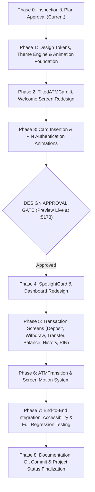

# APEX TOUCH BANKING — Frontend Redesign & Interaction Engineering Plan

## 1. Executive Summary & Objective

**APEX TOUCH BANKING** is a full-stack automated teller machine application. The Java OOP backend provides real-time banking logic, thread-safe financial transactions, session-based authentication, and domain rule validation.

The objective of this project is to elevate the frontend into a **Minimal Luxury + Premium Fintech + Interactive Touchscreen** experience inspired by Apple (Apple Wallet, Apple Card), Linear, Stripe, and Revolut Ultra, while strictly preserving 100% of the Java backend code, business rules, and API contracts.

---

## 2. Existing Architecture & Baseline Audit

### 2.1 Technology Stack
- **Backend**: Java 17 LTS, Spring Boot 3.3.4, Maven Wrapper (`mvnw.cmd`), Spring Web, Spring Validation, JUnit 5, in-memory thread-safe `Bank` singleton.
- **Frontend**: React 19.3.1, TypeScript 7.0.2, Vite 8.3.6, Tailwind CSS 3.4.17, Motion for React (`motion` v14.10.1), Lucide React 1.70.0, Axios 1.21.0, React Router DOM 7.18.5.
- **Authentication**: HTTP Session (`HttpSession`) with `JSESSIONID` cookie exchanged over `withCredentials: true` via Vite's `/api` proxy targeting `http://localhost:8080`.

### 2.2 Strict Non-Negotiable Backend Boundary
- **Zero backend modifications**: No Java classes, endpoints, method signatures, JSON structures, or business rules will be altered.
- **Single Source of Truth**: All balances, transaction IDs, timestamps, and card validations originate from the running Spring Boot service.

---

## 3. API Integration Inventory

| Endpoint | HTTP Method | Request Body Shape | Response Data Payload | Auth Required | Used By Component |
| :--- | :--- | :--- | :--- | :--- | :--- |
| `/api/auth/card` | `POST` | `{"cardNumber": string}` | `CardStatusResponse` (holder, type, expiry, blocked, expired, attempts) | No | `WelcomeScreen` / `WelcomePage` |
| `/api/auth/login` | `POST` | `{"cardNumber": string, "pin": string}` | `AuthSessionResponse` (authenticated, maskedCard, accountNo, customerName) | No | `PinAuthentication` / `PinPage` |
| `/api/auth/session` | `GET` | *None* | `AuthSessionResponse` | Optional | `AuthContext` (initial check) |
| `/api/auth/logout` | `POST` | *None* | `null` (Invalidates session) | Yes | `AtmKiosk` Header, `EjectPage` |
| `/api/auth/change-pin` | `POST` | `{"currentPin": string, "newPin": string, "confirmPin": string}` | `null` | Yes | `SecurityPin` / `ChangePinPage` |
| `/api/account/details` | `GET` | *None* | `AccountDetailsResponse` (full customer & account profile, balances) | Yes | `AuthContext`, `Dashboard` |
| `/api/account/balance` | `GET` | *None* | `BalanceResponse` (current, available, minimum) | Yes | `BalanceDetails`, `Dashboard` |
| `/api/transactions/deposit` | `POST` | `{"amount": number}` | `TransactionItemResponse` (txId, type, amount, balanceAfterTransaction) | Yes | `DepositScreen` / `DepositPage` |
| `/api/transactions/withdraw` | `POST` | `{"amount": number}` | `TransactionItemResponse` (txId, type, amount, balanceAfterTransaction) | Yes | `WithdrawalScreen` / `WithdrawPage` |
| `/api/transactions/transfer` | `POST` | `{"recipientAccountNumber": string, "amount": number}` | `TransactionItemResponse` (txId, type, amount, balanceAfterTransaction) | Yes | `TransferScreen` / `TransferPage` |
| `/api/transactions/recent` | `GET` | Query param: `?limit=5` | `List<TransactionItemResponse>` | Yes | `Dashboard`, `ActivityLedger` |

---

## 4. Design System: Minimal Luxury & Dual Theme

### 4.1 Design Philosophy
- **Restraint & Whitespace**: Spacing and refined typography create hierarchy rather than heavy boxes within boxes.
- **Lighting & Depth**: Specular sheen and radial pointer spotlights active primarily during hover/touch interactions.
- **Tone**: Pristine Apple / Revolut Ultra aesthetic with high contrast and accessibility.

### 4.2 Semantic Design Tokens (CSS Variables)

| Token | Light Theme | Dark Theme | Purpose |
| :--- | :--- | :--- | :--- |
| `--canvas` | `#F5F5F7` (Apple warm off-white) | `#0A0B0E` (Obsidian rich charcoal) | App backdrop |
| `--surface` | `#FFFFFF` (Pure white) | `#131519` (Elevated graphite) | Primary cards & chassis |
| `--surface-subdued` | `#EFEFF3` (Soft neutral grey) | `#191B21` (Dark graphite container) | Secondary tiles, keypads |
| `--surface-hover` | `#E5E5EB` | `#22262E` | Interactive hover state |
| `--border-subtle` | `#E2E4E9` (Delicate 1px border) | `rgba(255, 255, 255, 0.08)` | Hairline dividers |
| `--text-primary` | `#111827` (Deep near-black) | `#F9FAFB` (Soft anti-glare white) | Headings, balances |
| `--text-secondary` | `#6B7280` (Muted slate) | `#9CA3AF` (Cool grey) | Labels, subheadings |
| `--text-tertiary` | `#9CA3AF` | `#6B7280` | Timestamps, micro-copy |
| `--accent` | `#0066CC` (Apple cobalt blue) | `#3B82F6` (Electric sapphire) | Primary actions, links |
| `--accent-subtle` | `rgba(0, 102, 204, 0.08)` | `rgba(59, 130, 246, 0.12)` | Active pill highlights |

### 4.3 Typography System
- **Primary Font**: `Inter, -apple-system, BlinkMacSystemFont, "SF Pro Display", sans-serif` (tight tracking, refined weights 400, 500, 600).
- **Monospace Font**: `"JetBrains Mono", "SF Mono", monospace` (strictly reserved for currency figures, account IDs, card numbers, and timestamps).

---

## 5. Component Engineering Plan

### 5.1 Components to Create

1. **`TiltedATMCard.tsx`** (Priority 1 — Inspired by React Bits TiltedCard & Apple Card):
   - Perspective-based 3D rotation tracking pointer coordinates (`--rotate-x`, `--rotate-y`).
   - Dynamic specular lighting gradient (`--mouse-x`, `--mouse-y`) creating metallic sheen.
   - Realistic EMV chip, contactless wave glyph, laser-etched debossed typography.
   - Smooth spring return on pointer leave (`stiffness: 300, damping: 20`).
   - Graceful degradation on touchscreens (gyroscope or tap tilt).
   - Realistic mechanical insertion sequence: Card slides toward reader slot, dims slightly, triggers status LED, and activates PIN flow.

2. **`SpotlightCard.tsx`** (Priority 2 — Inspired by React Bits & Aceternity UI):
   - Mouse-tracking radial spotlight using CSS custom properties (`--mouse-x`, `--mouse-y`, `--spotlight-color`).
   - Spotlight visible primarily upon interaction (not permanent neon distraction).
   - Tactile spring press feedback (`whileTap={{ scale: 0.98 }}`).
   - Semantic color support for the 6 operation tiles:
     - Withdraw: Coral/Amber (`#FF5C5C`, `#FF8A00`)
     - Deposit: Emerald/Mint (`#10B981`, `#059669`)
     - Transfer: Cobalt/Cyan (`#0EA5E9`, `#3B82F6`)
     - Balance Details: Platinum/Ice Blue (`#E0E7FF`, `#A5B4FC`)
     - Activity Ledger: Muted Blue / Silver (`#94A3B8`, `#CBD5E1`)
     - Security & PIN: Violet/Indigo (`#8B5CF6`, `#6366F1`)

3. **`DecryptedText.tsx`** (Inspired by React Bits):
   - Masked-data reveal effect for card numbers (`•••• •••• •••• 1001`) and account numbers with sequential character resolution.

4. **`ATMTransition.tsx`**:
   - Reusable directional page transition wrapper utilizing `AnimatePresence` and spring curves (`cubic-bezier(0.2, 0.8, 0.2, 1)`).

5. **Animation Infrastructure**:
   - `src/animations/variants.ts`: Standardized fade, slide, scale, and stagger variants.
   - `src/animations/transitions.ts`: Spring physics configurations (`stiffness: 350, damping: 25`).
   - `src/styles/animations.css`: Keyframes for subtle ambient highlights.

### 5.2 Components & Pages to Redesign / Upgrade

| File / Component | Upgrades & Interactive Features |
| :--- | :--- |
| `WelcomePage.tsx` | Embed `TiltedATMCard`, physical card slot animation, public demo profiles (CARD1001-CARD1004) without exposing private PINs/balances, minimal card input. |
| `PinPage.tsx` | Apple Lockscreen aesthetic, compact identity badge, 4 spring-animated dots, circular tactile keypad, physical keyboard listener, error shake animation. |
| `DashboardPage.tsx` | Clean whitespace layout, prominent animated balance (`NumberTicker`), 6 `SpotlightCard` operation tiles with semantic lighting, recent transaction snippet. |
| `BalancePage.tsx` | Apple Wallet statement layout, animated count-up, ledger vs. available vs. minimum balance breakdown, receipt modal. |
| `DepositPage.tsx` | Fast denomination chips (₹500, ₹1000, ₹2000, ₹5000), custom amount keypad, realistic feeder intake state, instant backend credit refresh. |
| `WithdrawPage.tsx` | Fast cash pills, minimum balance guard, cash dispensing feedback, live backend deduction. |
| `TransferPage.tsx` | Recipient account input, live balance validation, Apple Pay-style confirmation sheet, instant reference code receipt. |
| `HistoryPage.tsx` | Stripe / Revolut style transaction ledger, filter tabs (All, Deposits, Withdrawals, Transfers), colored markers, timestamps. |
| `ChangePinPage.tsx` | Secure 4-digit PIN change form with verification and backend synchronization. |
| `EjectPage.tsx` | Card retrieval animation sliding out of reader slot, security prompt, auto-redirect countdown. |

---

## 6. Risk Assessment & Mitigation

| Risk | Impact | Mitigation Strategy |
| :--- | :--- | :--- |
| **Backend API mismatch** | Broken auth or transaction | Keep DTOs strictly synchronized (`balanceAfterTransaction`, `minimumBalance`, etc.); verify with automated MockMvc tests. |
| **Animation jank on low-end devices** | Poor UX | Use GPU-accelerated CSS transforms (`transform`, `opacity`), avoid layout thrashing, respect `prefers-reduced-motion`. |
| **Session state desynchronization** | Inconsistent balance display | Explicitly call `refreshBalance()` after all successful write operations (`deposit`, `withdraw`, `transfer`). |
| **Unintended backend edits** | Academic integrity violation | Strict rule: modify **only** files under `frontend/` and documentation files; never modify `src/com/bank/` or `src/model/`. |

---

## 7. Phased Implementation Roadmap

---

## 8. Immediate Next Step: Design Approval Gate (Phases 1–3)

Upon approval of this plan, we will immediately execute:
1. Animation foundations (`variants.ts`, `transitions.ts`, `animations.css`).
2. Interactive 3D `TiltedATMCard.tsx` with dynamic pointer sheen.
3. Upgraded `WelcomePage.tsx` with mechanical card insertion sequence.
4. Upgraded `PinPage.tsx` with Apple Lockscreen indicators and keypad feedback.
5. Launch live preview at `http://localhost:5173` for your design review.

