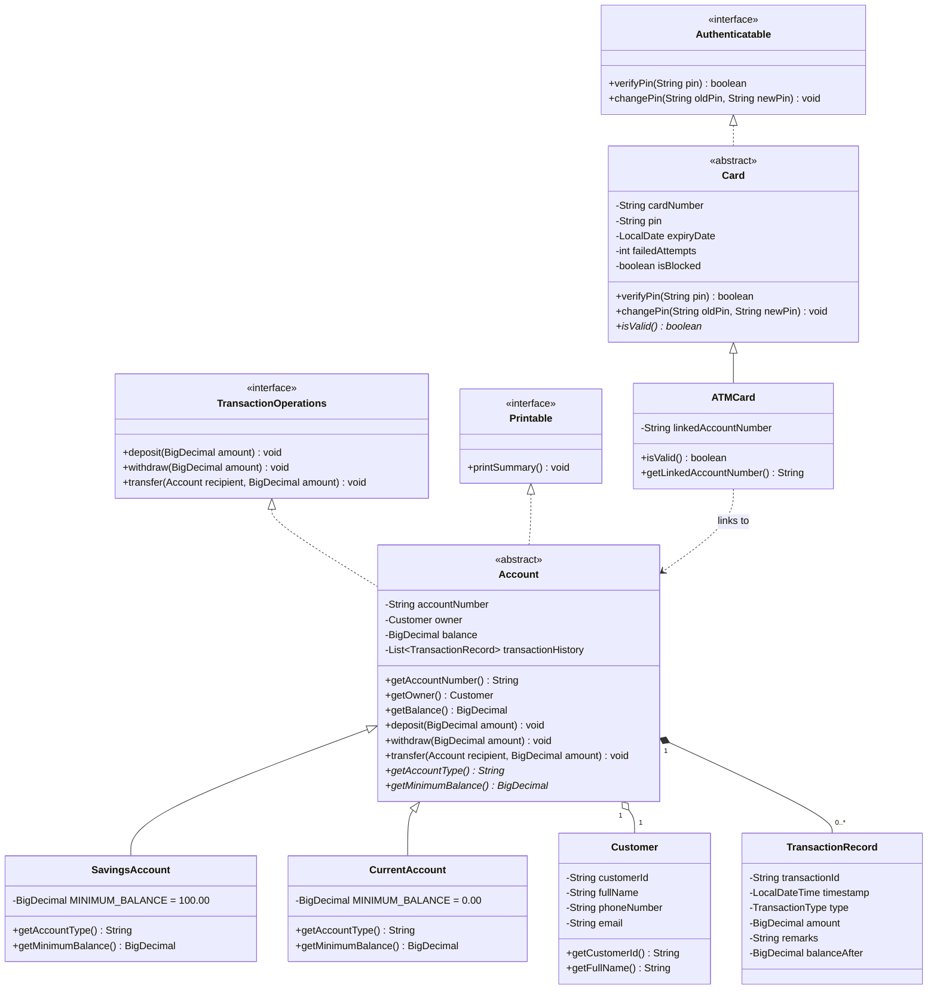

# Object-Oriented Programming (OOP) Architecture & Viva Reference

This document maps every fundamental OOP principle to its exact implementation in the **Apex Touch Banking** Java backend, specifically prepared for academic project viva defense and technical review.

---

## 1. Core OOP Pillars & Exact Code Mapping

### 1.1 Encapsulation (Information Hiding & Controlled Mutation)
- **Concept**: Data fields are declared `private` or `protected` and mutated only through audited, validated member methods. Direct access to balances or security state is strictly prohibited.
- **Concrete Demonstration in Code**:
  1. `model.Account`:
     - Fields `private final String accountNumber;`, `private final Customer owner;`, and `private BigDecimal balance;` are private.
     - **No public `setBalance()` exists anywhere in the codebase.**
     - The balance can only be mutated through `deposit(amount)`, `withdraw(amount)`, and `transfer(recipient, amount)`.
     - Each mutation method validates that the amount is strictly positive, has at most two decimal places (`scale <= 2`), and guarantees that `balance - amount >= getMinimumBalance()`.
  2. `model.Card`:
     - Fields `private String pin;`, `private int failedAttempts;`, and `private boolean isBlocked;` are private.
     - The PIN is never exposed via a getter. Verification happens internally via `verifyPin(candidatePin)`.
     - `failedAttempts` is auto-incremented on wrong entries and automatically transitions `isBlocked = true` upon reaching `MAX_FAILED_ATTEMPTS = 3`.

---

### 1.2 Abstraction (Interface Segregation & Template Contracts)
- **Concept**: Essential characteristics and contracts are defined without exposing lower-level implementation details. Callers interact with abstract contracts.
- **Concrete Demonstration in Code**:
  1. `model.Account` (Abstract Class):
     - Declares abstract methods:
       - `public abstract String getAccountType();`
       - `public abstract BigDecimal getMinimumBalance();`
     - Concrete accounts must define their identity and financial reserve rules, while inheriting universal transaction validation and history tracking.
  2. `interfaces.TransactionOperations`:
     - Interface declaring financial actions:
       - `void deposit(BigDecimal amount);`
       - `void withdraw(BigDecimal amount);`
       - `void transfer(Account recipient, BigDecimal amount);`
  3. `interfaces.Printable`:
     - Contract requiring `void printSummary();` implemented across Accounts and Cards.
  4. `interfaces.Authenticatable`:
     - Contract specifying authentication lifecycle (`verifyPin`, `changePin`).

---

### 1.3 Inheritance (Code Reuse & Specialization)
- **Concept**: Specialized subclasses inherit and extend state and behavior from a common ancestor.
- **Concrete Demonstration in Code**:
  1. `model.SavingsAccount extends model.Account`:
     - Inherits account number, owner, balance management, and transaction ledger.
     - Specializes the minimum balance to a mandatory reserve of **₹100.00**:
       ```java
       private static final BigDecimal MINIMUM_BALANCE = new BigDecimal("100.00");
       @Override
       public BigDecimal getMinimumBalance() { return MINIMUM_BALANCE; }
       ```
  2. `model.CurrentAccount extends model.Account`:
     - Inherits core account behavior but enforces a minimum balance of **₹0.00** (zero-balance account):
       ```java
       private static final BigDecimal MINIMUM_BALANCE = new BigDecimal("0.00");
       @Override
       public BigDecimal getMinimumBalance() { return MINIMUM_BALANCE; }
       ```
  3. `model.ATMCard extends model.Card`:
     - Inherits card number, hashed PIN, expiry date, and failed attempts tracking.
     - Adds `linkedAccountNumber` linking the physical card to a specific core bank account.

---

### 1.4 Polymorphism (Dynamic Method Dispatch & Runtime Specialization)
- **Concept**: A single method invocation on a base reference behaves differently at runtime depending on the actual concrete subtype.
- **Concrete Demonstration in Code**:
  1. **Runtime Validation in `Account.withdraw()`**:
     ```java
     // Inside abstract Account.java
     BigDecimal remaining = this.balance.subtract(amount);
     if (remaining.compareTo(getMinimumBalance()) < 0) {
         throw new InsufficientFundsException("Account would fall below minimum balance.");
     }
     ```
     When `account.withdraw(amount)` is called:
     - If `account` is a `SavingsAccount`, `getMinimumBalance()` dynamically resolves to **₹100.00**.
     - If `account` is a `CurrentAccount`, `getMinimumBalance()` dynamically resolves to **₹0.00**.
     - Callers (like `AtmWebService`) operate uniformly on `Account` without needing `instanceof` checks.

---

### 1.5 Robust Exception Handling (Custom Domain Exceptions)
- **Concept**: Exceptional financial conditions are represented by explicit, checked domain exceptions that map to user-friendly messages and appropriate HTTP statuses.
- **Exception Hierarchy**:
  - `InvalidPinException`: Thrown on incorrect PIN; tracks and reports remaining attempts.
  - `CardBlockedException`: Thrown when an already blocked card is inserted.
  - `CardExpiredException`: Thrown when a card past its expiry date is presented.
  - `InsufficientFundsException`: Thrown when a withdrawal or transfer would violate balance limits.
  - `InvalidAmountException`: Thrown on negative amounts, zero amounts, or invalid decimal precision.
  - `AccountNotFoundException`: Thrown when an account or beneficiary cannot be located.

---

### 1.6 Financial Correctness & Precision
- **Principle**: Floating-point representations (`float`, `double`) suffer from binary rounding errors (e.g., `0.1 + 0.2 = 0.30000000000000004`).
- **Implementation**:
  - **100% of monetary values use `java.math.BigDecimal`** with scale 2 and `RoundingMode.HALF_UP`.
  - Amounts with more than 2 decimal places are rejected immediately.
  - Calculations use `.add()`, `.subtract()`, and `.compareTo()` — never arithmetic operators.

---

## 2. UML Architecture Diagram


