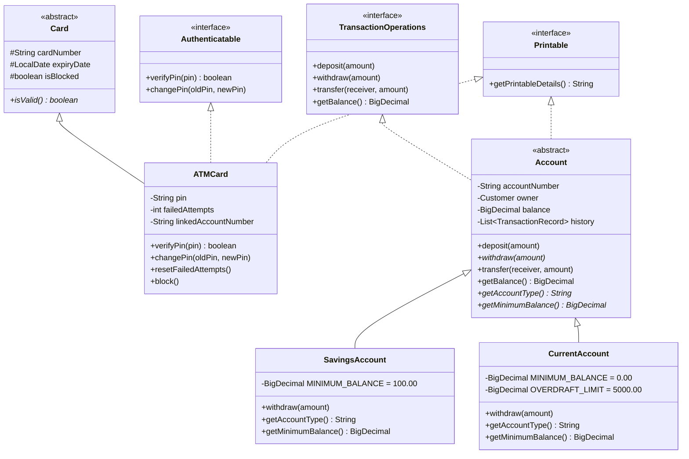

# APEX ATM SYSTEM — VIVA PREPARATION & TECHNICAL DEFENSE GUIDE

---

## 1. Project Overview & Core Topic

- **Topic**: **ATM Simulation System (Using Abstraction, Interfaces and Exception Handling)**
- **Domain**: Object-Oriented Financial Software Engineering
- **Implementation**: Java 17 LTS, Spring Boot 3.3.4 REST Backend, React 19 Touchscreen Kiosk UI, Embedded H2 Relational Database.
- **Core Repository**: `https://github.com/shini21/atm_system` (branch: `feature/premium-atm`)

---

## 2. Core OOP Concepts: The Academic Trifecta

### 2.1 Abstraction
> **Definition**: Hiding implementation complexity and exposing only essential features to the outside world.

#### How It Is Implemented:
1. **`abstract class Account` (`model.Account`)**:
   - Represents the conceptual bank account. It **cannot be directly instantiated** (`new Account(...)` is forbidden).
   - Contains abstract methods that subclasses **must** provide:
     ```java
     public abstract String getAccountType();
     public abstract BigDecimal getMinimumBalance();
     ```
   - Implements shared behavior like `deposit()`, `getBalance()`, and transaction history tracking, while enforcing that account types determine their own withdrawal boundaries.
2. **`abstract class Card` (`model.Card`)**:
   - Represents any bank card (debit, credit, prepaid).
   - Declares the abstract method:
     ```java
     public abstract boolean isValid();
     ```
   - Subclass `ATMCard` provides concrete validity logic (checking expiry date and block status).

---

### 2.2 Interfaces
> **Definition**: A pure contract specifying *what* a class must do, without prescribing *how* it does it. Interfaces enable multiple inheritance of type and decoupled architecture.

#### The Three Core Interfaces in the Project:
1. **`interfaces.Authenticatable`**:
   - Contract for entities secured by a 4-digit PIN.
   ```java
   public interface Authenticatable {
       boolean verifyPin(String pin) throws InvalidPinException;
       void changePin(String oldPin, String newPin) throws InvalidPinException;
   }
   ```
   - **Implemented by**: `ATMCard`. This separates card credentials from account balances.
2. **`interfaces.TransactionOperations`**:
   - Contract defining core financial operations:
   ```java
   public interface TransactionOperations {
       void deposit(BigDecimal amount) throws InvalidAmountException;
       void withdraw(BigDecimal amount) throws InvalidAmountException, InsufficientFundsException;
       void transfer(Account receiver, BigDecimal amount) throws InvalidAmountException, InsufficientFundsException;
       BigDecimal getBalance();
   }
   ```
   - **Implemented by**: `Account`. Any service or controller interacting with accounts codes against this interface rather than concrete implementations.
3. **`interfaces.Printable`**:
   - Contract for printable outputs (receipts, mini-statements, audit slips):
   ```java
   public interface Printable {
       String getPrintableDetails();
   }
   ```
   - **Implemented by**: Both `Account` and `ATMCard`.

#### Why Use Interfaces Instead of Abstract Classes?
- An abstract class is an **"is-a"** relationship (e.g. `SavingsAccount` *is an* `Account`).
- An interface is a **"can-do"** capability (e.g. `ATMCard` *can do* authentication &rarr; `Authenticatable`).
- Java allows a class to extend only **one** superclass, but implement **multiple** interfaces.

---

### 2.3 Exception Handling
> **Definition**: A structured mechanism for intercepting, reporting, and recovering from runtime errors and domain rule violations without terminating the application.

#### Custom Checked Exceptions (`src/com/bank/atm/exceptions/`):
All custom exceptions inherit from Java's `java.lang.Exception` (checked exceptions), ensuring that the compiler mandates explicit handling (`try-catch` or `throws`):

| Exception Class | Triggers When... | Mapped HTTP Status |
| :--- | :--- | :--- |
| `AccountNotFoundException` | Account number or card number does not exist in the bank registry. | `404 NOT FOUND` |
| `CardBlockedException` | User has exceeded 3 failed PIN attempts or card was manually locked. | `403 FORBIDDEN` |
| `CardExpiredException` | Card expiry date is before the current calendar date (`expiryDate.isBefore(today)`). | `400 BAD REQUEST` |
| `InsufficientFundsException` | Requested withdrawal or transfer violates the account's minimum balance. | `400 BAD REQUEST` |
| `InvalidAmountException` | Amount is negative, zero, has more than 2 decimal places, or is not a multiple of ₹100. | `400 BAD REQUEST` |
| `InvalidPinException` | PIN is not exactly 4 digits or does not match the stored BCrypt hash. | `401 UNAUTHORIZED` |
| `InvalidMenuChoiceException` | In the console interface, user selects an option outside the valid menu range. | N/A (Console) |

#### Centralized Exception Handling (`GlobalExceptionHandler`):
In the web application, `@RestControllerAdvice` captures every thrown domain exception across all REST controllers and transforms it into a standardized JSON envelope:
```json
{
  "success": false,
  "message": "Insufficient funds. Account must maintain a minimum balance of INR 100.00.",
  "data": null,
  "timestamp": "2026-11-13T22:30:00"
}
```

---

## 3. Class-by-Class Architecture Walkthrough



### Detailed Class Descriptions:
1. **`model.Account`**:
   - Abstract superclass enforcing encapsulation. The `balance` field is `private` and modified only through `deposit()`, `withdraw()`, and `transfer()`.
   - Uses `BigDecimal` exclusively with scale 2 to prevent floating-point rounding errors.
2. **`model.SavingsAccount`**:
   - Subclass representing a personal savings account.
   - Enforces `MINIMUM_BALANCE = 100.00`. If `balance - amount < 100.00`, throws `InsufficientFundsException`.
3. **`model.CurrentAccount`**:
   - Subclass representing a commercial business account.
   - Allows overdraft up to ₹5,000.00 with `MINIMUM_BALANCE = 0.00`.
4. **`model.ATMCard`**:
   - Implements `Authenticatable`. Tracks `failedAttempts`. On 3 bad attempts, permanently blocks itself.
5. **`model.Customer`**:
   - Immutable representation of the bank customer (ID, Name, Phone, Email).
6. **`model.TransactionRecord`**:
   - Immutable audit ledger entity recording `transactionId`, `type` (`DEPOSIT`, `WITHDRAWAL`, `TRANSFER_IN`, `TRANSFER_OUT`), `amount`, `balanceAfter`, and `timestamp`.
7. **`service.CashDispenserService`**:
   - Implements the greedy denomination coin-change algorithm under finite note inventory (`₹500`, `₹200`, `₹100`).
8. **`service.AtmPersistenceService`**:
   - Spring Service executing `@Transactional` operations against Spring Data JPA repositories. Generates monotonically increasing unique transaction IDs (`AtomicLong(System.currentTimeMillis())`).
9. **`service.PinSecurityService`**:
   - Manages cryptographic salted hashing using `BCryptPasswordEncoder(10)`.

---

## 4. Complete ATM Operation Workflows

### 4.1 Card Insertion & PIN Verification Flow
1. User enters or selects Card Number (`CARD1001`).
2. Frontend calls `POST /api/auth/card`.
3. Backend checks existence, checks `expiryDate.isBefore(LocalDate.now())`, and checks `isBlocked`. If invalid, throws typed exception.
4. User enters 4-digit PIN (`1234`).
5. Frontend calls `POST /api/auth/login`.
6. `PinSecurityService` verifies PIN using BCrypt constant-time comparison.
7. If incorrect: increments `failedAttempts`. If `failedAttempts >= 3`, sets `blocked = true` and throws `CardBlockedException`.
8. If correct: resets `failedAttempts = 0`, binds card and account number to servlet session (`JSESSIONID`), and returns `200 OK`.

---

### 4.2 Cash Withdrawal with Greedy Denomination Breakdown
1. User enters amount (e.g. ₹2,700).
2. Frontend validates: positive, multiple of 100, $\le$ available balance.
3. Frontend calls `POST /api/transactions/withdraw`.
4. Backend retrieves authenticated account from `HttpSession`.
5. Checks minimum balance invariant: `balance - amount >= minimumBalance`.
6. Invokes `CashDispenserService.calculateBreakdown(2700)`:
   - ₹500 notes: $\min(\lfloor 2700 / 500 \rfloor, \text{inventory}) = 5$ notes (₹2,500). Remaining: ₹200.
   - ₹200 notes: $\min(\lfloor 200 / 200 \rfloor, \text{inventory}) = 1$ note (₹200). Remaining: ₹0.
   - ₹100 notes: 0 notes.
   - Breakdown: `{500: 5, 200: 1}`.
7. Decrements physical ATM inventory in database.
8. Deducts ₹2,700 from user's account balance.
9. Creates and saves `TransactionEntity` with unique monotonic ID (`TXN-...`).
10. Returns `200 OK` with updated balance and denomination map to trigger the motorized dispenser animation on the kiosk.

---

### 4.3 Inter-Account Funds Transfer & Deadlock Avoidance
1. User specifies recipient account (`ACC1002`) and amount (e.g. ₹500).
2. Backend verifies sender $\neq$ recipient, verifies recipient exists, and verifies sender has sufficient funds.
3. To prevent circular deadlocks during concurrent transfers:
   - Locks are acquired in **lexicographical order** (`sender.compareTo(receiver)`).
4. Inside a single `@Transactional` boundary:
   - Deducts amount from sender account.
   - Adds amount to recipient account.
   - Saves `TRANSFER_OUT` record on sender ledger.
   - Saves `TRANSFER_IN` record on recipient ledger.
5. If any database constraint fails, Spring rolls back both accounts (**Atomicity**).

---

## 5. Top 25 Viva / Technical Interview Questions & Answers

### Question 1: What are the main OOP concepts demonstrated in this project?
> **Answer**: All four pillars of Object-Oriented Programming:
> 1. **Abstraction**: Through abstract classes `Account` and `Card`, hiding internal balance management and exposing only high-level operations.
> 2. **Encapsulation**: Private state variables (`balance`, `pinHash`, `failedAttempts`) accessible only through validated getters and domain methods.
> 3. **Inheritance**: `SavingsAccount` and `CurrentAccount` extend `Account`; `ATMCard` extends `Card`.
> 4. **Polymorphism**: `Account.withdraw()` behaves differently at runtime based on whether the actual instance is a `SavingsAccount` (minimum balance constraint) or `CurrentAccount` (overdraft capability).

---

### Question 2: Why did you use `BigDecimal` instead of `double` or `float` for currency?
> **Answer**: `double` and `float` are binary floating-point representations (IEEE 754 standard). They cannot represent decimal fractions like `0.1` or `0.01` accurately, leading to catastrophic cumulative rounding errors (e.g. `0.1 + 0.2 = 0.30000000000000004`). In banking, exact decimal representation is mandatory. `BigDecimal` provides arbitrary-precision signed decimal numbers with strict scale control (scale = 2, `RoundingMode.UNNECESSARY`).

---

### Question 3: What is the difference between checked and unchecked exceptions? Which did you use?
> **Answer**:
> - **Checked Exceptions** (inherit from `java.lang.Exception`): Enforced at compile-time; the compiler forces the programmer to handle them with `try-catch` or declare them with `throws`.
> - **Unchecked Exceptions** (inherit from `java.lang.RuntimeException`): Occur due to programming bugs (e.g. `NullPointerException`, `IndexOutOfBoundsException`) and are not checked at compile time.
> - **In this project**: All 7 core domain exceptions (`AccountNotFoundException`, `InsufficientFundsException`, `InvalidPinException`, etc.) are **checked exceptions** because financial edge cases are predictable business conditions that callers must handle explicitly.

---

### Question 4: How does polymorphism work in your withdrawal logic?
> **Answer**: Callers (such as `AtmWebService` or `ATM.java`) hold a generic reference of type `Account`:
> ```java
> Account account = bank.findAccountByNumber("ACC1001");
> account.withdraw(amount);
> ```
> At runtime, Java uses dynamic method dispatch. If `account` points to a `SavingsAccount`, it checks the ₹100 minimum balance. If it points to a `CurrentAccount`, it allows overdraft down to -₹5,000. The calling service doesn't need `if-else` or `instanceof` checks.

---

### Question 5: Why did you separate `Card` and `Account` into two different classes?
> **Answer**: This follows the **Single Responsibility Principle (SRP)**:
> - An `Account` represents the financial ledger and balance.
> - A `Card` represents an authentication mechanism and access medium.
> In real banking, a customer can have multiple cards linked to one account, or replace an expired card without altering their account number or balance history. Combining them would violate separation of concerns.

---

### Question 6: What happens when a user enters the wrong PIN 3 times?
> **Answer**: Each incorrect PIN entry increments the `failedAttempts` counter on `ATMCard` / `CardEntity`. When `failedAttempts` reaches 3, the card's `isBlocked` flag is set to `true`, and an `InvalidPinException` ("Card is now blocked") is thrown. Any future login attempts immediately throw `CardBlockedException` (HTTP 403 Forbidden). The card remains blocked until an authorized branch manager unblocks it via the `/api/atm/unblock` administrative endpoint.

---

### Question 7: How does the Cash Dispenser determine which notes to give?
> **Answer**: It uses a **Greedy Coin-Change Algorithm with Finite Inventory**:
> 1. Denominations are sorted descending: `[500, 200, 100]`.
> 2. For each denomination, it takes the maximum notes possible without exceeding either the remaining amount or the available banknote stock in the physical hopper:
>    $$\text{count} = \min\left(\lfloor \text{remaining} / \text{denom} \rfloor, \text{availableNotes}\right)$$
> 3. If a non-zero remainder exists after evaluating all denominations (e.g. requested ₹300, but only ₹500 notes remain), the transaction is cleanly aborted with an `InvalidAmountException` before any account balance is debited.

---

### Question 8: How do you prevent circular-wait deadlocks during transfers?
> **Answer**: If User A transfers to User B while User B transfers to User A simultaneously, locking Account A then Account B in Thread 1 and Account B then Account A in Thread 2 causes a classic Coffman circular-wait deadlock. We eliminate this by enforcing **lexicographical lock ordering**:
> ```java
> Account firstLock = sender.getAccountNumber().compareTo(receiver.getAccountNumber()) < 0 ? sender : receiver;
> Account secondLock = firstLock == sender ? receiver : sender;
> synchronized (firstLock) {
>     synchronized (secondLock) { ... }
> }
> ```
> Because locks are always acquired in alphabetical order (`ACC1001` before `ACC1002`), deadlock is impossible.

---

### Question 9: How does the web application maintain security without storing plaintext PINs?
> **Answer**: PINs are hashed using **BCrypt** with an automatically generated cryptographic salt and a work factor of 10 (`$2a$10$...`). When a user logs in, `pinSecurityService.verifyPin(rawPin, hash)` hashes the incoming PIN with the salt stored inside the hash and checks equality in constant time, preventing rainbow table attacks and side-channel timing attacks.

---

### Question 10: What ensures that financial transactions are ACID compliant?
> **Answer**:
> - **Atomicity**: Spring's `@Transactional` annotation rolls back the entire database transaction if any exception is thrown midway.
> - **Consistency**: Invariants (minimum balance, positive amounts, note multiples) are verified prior to persisting.
> - **Isolation**: Database transactions run under Read Committed isolation, preventing dirty reads.
> - **Durability**: All commits are flushed to the persistent H2 database file on disk (`./data/atm_db.mv.db`).

---

### Question 11: What is the purpose of the `Printable` interface?
> **Answer**: It defines a contract `getPrintableDetails()` for any object that can produce human-readable textual output for an ATM receipt printer or statement slip. Both `Account` and `ATMCard` implement it, adhering to the Interface Segregation Principle.

---

### Question 12: Why are setters omitted on the `Account` class?
> **Answer**: To enforce **encapsulation and audit integrity**. If `setBalance(BigDecimal newBalance)` existed, any part of the code could arbitrarily rewrite account balances without recording a transaction, creating ledger inconsistencies and security loopholes. Balance can only change via audited `deposit()`, `withdraw()`, and `transfer()` methods.

---

### Question 13: How does session management work between frontend and backend?
> **Answer**: Upon successful PIN verification, Spring Boot establishes an `HttpSession` and sets a secure `JSESSIONID` cookie with `HttpOnly` and `SameSite=Lax` attributes. The React frontend sends this cookie on every subsequent request (`withCredentials: true`). If a user attempts to call financial APIs without an active session, `AtmWebService.getAuthenticatedAccount()` throws an `IllegalStateException` mapped to HTTP 401 Unauthorized.

---

### Question 14: How does the system handle inactivity timeouts?
> **Answer**: On the backend, `server.servlet.session.timeout` sets a server-side session expiration. On the frontend, `HardwareContext` tracks user interactions (clicks, keypresses, mouse movement) with a 120-second inactivity countdown timer. If no action occurs, a warning is displayed, the card is motorized into the ejected state, and the user is redirected to `/eject?reason=timeout`.

---

### Question 15: What is the role of `AtmWebService` vs `AtmPersistenceService`?
> **Answer**:
> - `AtmWebService` is the application orchestrator. It manages the user's `HttpSession`, validates session authentication, and synchronizes the domain models with the presentation layer.
> - `AtmPersistenceService` is the data service. It manages database transactions, interacts with Spring Data JPA repositories, updates physical ATM cash inventories, and ensures persistent relational storage.

---

### Question 16: Can the original console project still be compiled without Spring Boot or Node.js?
> **Answer**: Yes. The original CLI application in `src/com/bank/atm/Main.java` is 100% self-contained. It can be compiled using standard `javac`:
> ```bash
> javac -d bin -sourcepath src src/com/bank/atm/Main.java
> java -cp bin com.bank.atm.Main
> ```
> Both the CLI and the Web Application share the exact same domain classes.

---

### Question 17: How did you ensure unique transaction IDs across system restarts?
> **Answer**: In-memory static integer counters reset to 1000 on application restart, causing primary key collisions in the database. We solved this by seeding an `AtomicLong` with `System.currentTimeMillis()`, generating monotonic, chronologically ordered IDs like `TXN-1794589397635`.

---

### Question 18: What is the purpose of `GlobalExceptionHandler`?
> **Answer**: It is a centralized Spring `@RestControllerAdvice` component that intercepts all exceptions thrown across any controller. It maps domain exceptions (e.g. `InsufficientFundsException`) to precise HTTP error codes (e.g. 400 Bad Request) and returns a consistent, clean JSON structure while logging unexpected exceptions internally to prevent server information leaks.

---

### Question 19: How are account numbers masked in the UI?
> **Answer**: To protect customer privacy, account numbers are masked according to PCI-DSS standards (`ACC••••1001`), showing only the prefix and last four digits across dashboard headers, receipts, and ledger statements.

---

### Question 20: How does the frontend communicate with the backend?
> **Answer**: Over RESTful HTTP JSON APIs. The Vite development server configures a reverse proxy forwarding all `/api/*` traffic from `http://localhost:5173` to `http://localhost:8080`, sharing authentication cookies seamlessly without cross-origin CORS conflicts.

---

### Question 21: What is the difference between `savingsAccount.calculateInterest()` and `currentAccount.getOverdraftLimit()`?
> **Answer**: It is an example of domain-specific specialization:
> - `SavingsAccount` has an annual interest rate (e.g. 3.5%) and a method to project accrued interest.
> - `CurrentAccount` has an overdraft facility allowing balance to drop below zero up to a pre-approved credit limit of ₹5,000.

---

### Question 22: What design patterns are used in this project?
> **Answer**:
> 1. **MVC (Model-View-Controller)**: Controllers handle routing, Models hold state, React handles the view.
> 2. **Singleton Pattern**: Managed Spring Beans (`Bank`, `CashDispenserService`, `PinSecurityService`).
> 3. **Repository Pattern**: Spring Data JPA repositories abstract database SQL operations.
> 4. **Strategy / Polymorphic Pattern**: Account hierarchy determines withdrawal and minimum balance strategies dynamically.
> 5. **Observer / Listener Pattern**: `HardwareContext` registers hardware keypad and side function key event listeners.

---

### Question 23: How does the touch keypad support laptop keyboards?
> **Answer**: `HardwareContext.tsx` registers a global `keydown` event listener that maps top-row number keys (`Digit0–9`), laptop numeric keypads (`Numpad0–9` regardless of NumLock state), `NumpadEnter`, `NumpadDecimal`, `Backspace`, and `Escape` to physical ATM buttons while providing visual button depression feedback.

---

### Question 24: What database is used and where is data saved?
> **Answer**: An embedded **H2 Relational Database** in file-backed mode (`jdbc:h2:file:./data/atm_db`). All tables (`customers`, `accounts`, `cards`, `transactions`, `atm_inventory`) are persistently saved to disk in `./data/atm_db.mv.db`.

---

### Question 25: How would you summarize the architecture in one sentence?
> **Answer**: "The APEX ATM System is an N-tier, object-oriented banking application that implements rigorous abstraction, interface contracts, and checked exception handling in Java 17, coupled with an ACID-compliant Spring Boot 3 persistence engine and an accessible React 19 physical kiosk interface."

